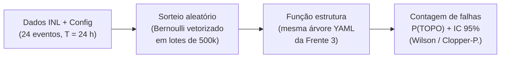
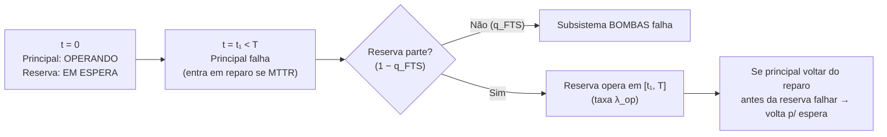

# Frente 4 — Roteiro de Apresentação (Simulação de Monte Carlo)

---

## Slide 1 — Como funciona a Simulação de Monte Carlo no CCWS

### Conteúdo sugerido no slide

- **Objetivo:** estimar $P(\text{TOPO})$ numericamente e modelar comportamentos temporais além da árvore estática (**bomba em espera** e **reparo**).
- **Fluxo de cada história simulada ($N = 1.000.000$, semente fixa `20262`, $T = 24\text{ h}$):**

- **Por que além do analítico?**
  - Confirma a solução da árvore estática de forma independente.
  - Permite introduzir dependência temporal: **bomba reserva em espera** e **manutenção/reparo (DES)**.

### Notas

> "Na Frente 4, nós simulamos o comportamento do CCWS por Monte Carlo usando exatamente a mesma árvore de falhas da Frente 1 e os dados do INL da Frente 2. Em cada uma das 1 milhão de histórias, sorteamos quais dos 24 componentes falharam em 24 horas, aplicamos a função estrutura da árvore de forma vetorizada e contamos em quantas histórias os dois trens caíram juntos. Além de validar o cálculo analítico, a simulação nos permite ir além da árvore estática para testar bomba reserva em espera e reparo."

## Slide 2 — Bomba em espera (_Cold Standby_) e Reparo (DES)

### Conteúdo sugerido no slide

- **Diferença física nas bombas (`MDP_A/C` no Trem A; `MDP_B/D` no Trem B):**
  - _Árvore estática:_ redundância ativa (as duas bombas expostas juntas desde $t = 0$).
  - _Cold standby:_ a reserva só é acionada se a principal falhar em $t_1 < T$.
- **Decomposição dos dados do INL (Table 1):**
  - Falha na partida (`MDP-FTS-CCW`): $q_{\text{FTS}} = 4{,}57 \times 10^{-4}$ / demanda.
  - Taxa em operação (`FTR + ELS + ELL`): $\lambda_{\text{op}} = 1{,}98 \times 10^{-6}\text{ h}^{-1}$.
- **Linha do tempo (Simulação a Eventos Discretos — DES):**

- **Status do reparo (MTTR):** motor DES implementado e validado contra Cadeia de Markov de 3 estados (`pytest`), mas **sem dados de MTTR inventados** (aguardando fonte documentada para rodar via `--mttr-csv`).

### Notas

> "Para modelar a bomba em espera sem mexer na árvore do grupo, separamos os dados do INL em dois pedaços: falha na partida da bomba reserva e falha durante operação contínua. Na espera fria, a bomba reserva não se desgasta enquanto a principal está rodando; ela só recebe uma demanda de partida se a principal falhar antes das 24 horas. Também implementamos o motor completo de eventos discretos com reparo — já validado matematicamente contra Cadeia de Markov nos testes —, mas seguindo a regra do trabalho não inventamos valores de MTTR; o código já aceita a tabela assim que houver fonte documentada."

---

## Slide 3 — Convergência e o desafio do Evento Raro

### Conteúdo sugerido no slide

- **Achado-chave:** com $P(\text{TOPO}) \approx 1{,}1 \times 10^{-5}$, em $10^6$ histórias ocorrem apenas **11 falhas** → erro relativo de **30,15%** (IC 95% Wilson mais adequado que Wald).
- **Dimensionamento binomial ($O(N^{-1/2})$):**
  - Para $\text{SE}/\hat{p} \le 10\%$: **~9,1 milhões** de histórias.
  - Para IC 95% $\le \pm 10\%$: **~34,9 milhões** de histórias.

### Notas

> "Este gráfico mostra a convergência da simulação. No painel de cima, vemos a estimativa de P(TOPO) e a faixa do intervalo de confiança de 95% de Wilson se estreitando conforme aumentamos o número de histórias. No painel de baixo, o erro relativo segue exatamente a reta teórica proporcional a N elevado a menos meio. Como a perda simultânea dos dois trens é um evento raro — da ordem de 10⁻⁵ —, em 1 milhão de histórias observamos só 11 falhas, o que dá um erro relativo de 30%. Pela fórmula de dimensionamento, baixar esse erro para 10% exige cerca de 9 milhões de histórias, e para ter ±10% no intervalo de confiança, cerca de 35 milhões."

---

## Slide 4 — O que deu: Caso Base e Impacto da Bomba em Espera

### Conteúdo sugerido no slide

- **Resultado no Evento Topo ($T = 24\text{ h}$, $N = 10^6$):**

| Modelo                                  | Falhas ($k$) | $\hat{P}(\text{TOPO})$ | IC 95% (Wilson)             |
| --------------------------------------- | -----------: | ---------------------: | --------------------------- |
| Redundância ativa (base)                |           11 |        **1,10 × 10⁻⁵** | [6,14 × 10⁻⁶ ; 1,97 × 10⁻⁵] |
| Cold standby (principal operando)       |           11 |        **1,10 × 10⁻⁵** | [6,14 × 10⁻⁶ ; 1,97 × 10⁻⁵] |
| Cold standby (principal parte em $t=0$) |           11 |        **1,10 × 10⁻⁵** | [6,14 × 10⁻⁶ ; 1,97 × 10⁻⁵] |

- **Olhando isoladamente o subsistema `BOMBAS_A`:**

### Notas

> "Aqui está o resultado mais interessante da nossa simulação. Quando olhamos só para o par de bombas, a espera fria faz uma diferença enorme: em 24 horas, com a bomba principal já rodando, a probabilidade de falha cai cerca de 11 vezes; em 1 ano, cai pela metade — de 308 para 156 falhas em 1 milhão de histórias, batendo na risca com a curva analítica. Porém, quando colocamos isso no CCWS completo em 24 horas, os três modelos dão exatamente o mesmo P(TOPO) de 1,10 × 10⁻⁵. Por quê? Porque os outros 10 componentes em série de cada trem — válvulas e instrumentação — falham na casa de 10⁻³, enquanto o par de bombas falha na casa de 10⁻⁸ a 10⁻⁷."

---

## Slide 5 — Principais Conclusões da Frente 4

### Conteúdo sugerido no slide

1. **Consistência verificada:** $\hat{P}(\text{TOPO}) = 1{,}10 \times 10^{-5}$ (IC 95% Wilson `[6,14E-6 ; 1,97E-5]`) compatível com a solução analítica, com 68 testes automatizados (incluindo Erlang e Markov 3 estados).
2. **Evento raro exige cuidado estatístico:** em $N = 10^6$ ($k = 11$), o IC de Wilson/Clopper-Pearson evita a distorção do Wald; precisão de 10% demanda $N \sim 10^7\text{–}3{,}5 \times 10^7$ (ou redução de variância).
3. **Insight de engenharia do CCWS:** operar a segunda bomba em espera fria reduz em até **11×** (24 h) e **2×** (1 ano) a falha do bombeamento, mas no sistema completo em 24 h (sem CCF) o gargalo continua nos componentes em série do trem — onde manutenção e confiabilidade trazem maior ganho.

### Notas de fala (Cauê)

> "Fechando a parte de Monte Carlo com três mensagens: primeiro, a simulação reproduziu com consistência a árvore do CCWS e foi validada analiticamente em testes automatizados; segundo, mostramos quantitativamente o custo estatístico de simular eventos raros na casa de 10⁻⁵; e terceiro, o resultado físico principal é que, embora a bomba em espera melhore muito o subsistema de bombeamento, em missões de 24 horas o risco global do CCWS é dominado pelos componentes em série de cada trem, o que conversa diretamente com a análise de importância e sensibilidade das outras frentes."
